# Agent Orchestrator 全面梳理：架构、模块与多 Agent 上下文控制

Updated: 2026-09-21. 性质：只读代码调研报告（供二次开发/贡献者入门参考）。
核验方式：全部结论来自对源码的逐文件阅读（部分到行号），非猜测；少量未逐行确认的点已标注"未确认"。
注意：本文是时点快照，与代码冲突时以代码和[契约层](../documentation-map.md)为准。

## 目录

- [第一部分：项目全面梳理](#第一部分项目全面梳理)
  - [1. 项目定位](#1-项目定位)
  - [2. 技术架构](#2-技术架构)
  - [3. 功能模块划分](#3-功能模块划分)
  - [4. 数据流图](#4-数据流图)
  - [5. 核心机制](#5-核心机制)
  - [6. 承重规则（改动红线）](#6-承重规则改动红线)
  - [7. 贡献入口建议](#7-贡献入口建议)
- [第二部分：多 Agent 上下文控制机制](#第二部分多-agent-上下文控制机制)
  - [8. 核心设计哲学：AO 不拥有上下文](#8-核心设计哲学ao-不拥有上下文)
  - [9. 隔离层：多 Agent 之间从不共享上下文](#9-隔离层多-agent-之间从不共享上下文)
  - [10. 注入层：往 agent 上下文里放什么、放几次](#10-注入层往-agent-上下文里放什么放几次)
  - [11. 搬运层：切换时的上下文边界](#11-搬运层切换时的上下文边界)
  - [12. 治理层：会话内的上下文收缩与分叉](#12-治理层会话内的上下文收缩与分叉)
  - [13. 二开时的设计决策参考](#13-二开时的设计决策参考)

---

# 第一部分：项目全面梳理

## 1. 项目定位

一个长期运行的本地 Go 守护进程（daemon）+ Electron/React 桌面监督端，用来在一个看板里并行规划、运行、观察多个 AI 编码 agent 会话。每个项目会话拥有隔离的 git worktree，支持 TUI（tmux/ConPTY 终端）与 Chat（原生协议）双模态，并覆盖 spawn → PR → CI → review → merge 全流程。

分发形态：桌面应用（GitHub Releases）是唯一活跃渠道并自动更新；npm 包 `@aoagents/ao` 冻结在 0.10.0（legacy on-ramp，`ao start` 只负责解析/下载并打开桌面 app，不再自跑 daemon）。

## 2. 技术架构

### 2.1 技术栈

| 层 | 选型 | 说明 |
|---|---|---|
| 后端语言 | Go 1.25.7+（go.work 要求 1.26.5），stdlib 优先 | 明确禁用 GORM、Gin/Fiber、go-git、viper、Temporal/NATS/Kafka/Redis（见 `docs/stack.md`） |
| HTTP | `chi` router + `coder/websocket` | 单 loopback 端口 **3001**（REST + SSE + WS + 健康检查） |
| 存储 | **SQLite**（modernc.org/sqlite，WAL）+ goose 迁移（**132 个**）+ **sqlc** 生成代码 | 生成物 `gen/` 禁止手改 |
| 事件 | **CDC**：DB 触发器 → `change_log` → poller → 广播器 → SSE | 唯一事件源，无手动 CDC 发射 |
| 终端 | tmux / macOS 原生 PTY host / Windows ConPTY + `vt-go` VT 模拟器 | macOS/Linux 新会话默认走 detached PTY host，失败回退 tmux |
| CLI | Cobra（薄客户端，只走 HTTP） | `usageError`→退出码 2，运行失败→1 |
| 前端 | Electron（forge ^7.8）+ React 19 + TanStack Router/Query + Tailwind 4 + zustand + xterm.js + Lexical | userData 固定 `~/.ao/electron` |
| 类型契约 | Go DTO → `go generate` → `openapi.yaml` → `openapi-typescript` → `frontend/src/api/schema.ts` | CI 有 `api-drift`/`sqlc-drift` 双漂移门禁 |
| 移动端 | Expo SDK 57 + RN 0.86（`packages/mobile`） | 走 opt-in 的 LAN 监听器（**3011**），bearer 口令认证 |
| 其他 | PostHog/Sentry 遥测（默认关）、cloudflared tunnel、WorkOS（cloud 控制面） | |

### 2.2 架构总览（分层）

核心原则：**端口-适配器（hexagonal）架构**。核心服务只依赖 `internal/ports/` 接口，适配器只实现接口、是"叶子"（禁止反向 import 核心）。

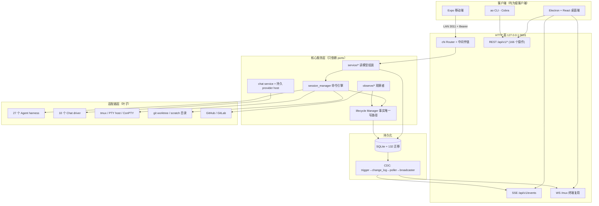

### 2.3 仓库布局

```
agent-orchestrator/
├── backend/          # Go 重写主体（唯一活跃后端）
│   └── internal/
│       ├── domain/         # 领域词汇 + 持久事实记录（SessionRecord/ActivityState…）
│       ├── ports/          # 入站/出站接口（唯一依赖方向汇聚点）
│       ├── service/        # project/session/chat/pr/review/notification/usage…
│       ├── session_manager/# 会话命令引擎（spawn/kill/send/switch/handoff）
│       ├── lifecycle/      # LCM：activity_state + is_terminated 归约器
│       ├── observe/        # scm(30s)/reaper(5s)/activity(30s)/trackerintake(1min)
│       ├── storage/sqlite/ # migrations(132) + queries(23) + gen + store(~20 文件)
│       ├── cdc/            # change_log poller + broadcaster
│       ├── httpd/          # chi 路由、31 个控制器、终端 mux、LAN 监听器、apispec
│       ├── terminal/       # /mux JSON 多路复用协议
│       ├── adapters/       # agent/chatdriver/runtime/workspace/scm/tracker/reviewer…
│       ├── daemon/         # 生产装配（daemon.Run()）
│       └── cli/            # Cobra 命令（薄 HTTP 客户端）
├── frontend/         # Electron + React（main/preload/renderer）+ 内置 landing/docs 站
├── packages/         # mobile(Expo) / product-ui(共享组件) / ao(冻结 npm 包) / cloud-client
├── cloud/            # AO Cloud 私有控制面（独立 Go module，Postgres）
├── contracts/        # cloud/openapi.yaml 公共契约
├── pricing/          # 模型定价目录（CI 校验）
├── test/             # 外部 e2e（真实 ao 二进制 + Playwright Electron）
└── docs/             # 架构/STATUS/ADR/开发指南
```

## 3. 功能模块划分

### 3.1 后端模块（按职责）

| 模块 | 位置 | 职责与关键事实 |
|---|---|---|
| **Daemon 装配** | `backend/internal/daemon/daemon.go` | `Run()` 约 20 步装配：config → SQLite → CDC → 终端 manager → LCM+观察者 → 各服务 → httpd（全部依赖注入一处）→ LAN 监听器 → supervisor socket。**关机不 teardown 会话**，下次启动 Reconcile 收养 |
| **HTTP API** | `internal/httpd/` | 31 个控制器、166 个操作。特殊端点：`GET /mux`（终端 WS）、`POST /shutdown`、`GET /api/v1/events`（CDC SSE，支持 Last-Event-ID 断点续传）。中间件链：RequestID→日志→recover→CORS→presence |
| **鉴权** | `httpd/auth.go` + `lan_listener.go` | loopback 永无鉴权（bind host 不可配）；LAN 监听器仅 Connect Mobile 开启时绑 `0.0.0.0:3011`，bearer 口令 + 锁定；唯一豁免 `GET /api/v1/identity`（ADR 0003）；`lanControlBlock` 把 `/shutdown`、`/internal/*`、mobile/browser/dev 等在 LAN 上一律 404 |
| **服务层** | `internal/service/*` | `session`：只读 store + 派生状态，写命令全部委托 session_manager；`chat`：每会话一个 controller + provider 事件投影到 conversation 表；`project/pr/review/notification/usage/settings/shellterm` 各管一域 |
| **session_manager** | `internal/session_manager/` | 会话**命令执行**：spawn（agentlaunch）、kill、send、restore、agent 切换 saga、TUI↔Chat interface transition、prompt 构造。调用 LCM 写事实，不自定状态语义 |
| **lifecycle (LCM)** | `internal/lifecycle/` | **持久状态唯一写路径**。只写两类事实：`activity_state`（active/idle/waiting_input/blocked/exited）+ `is_terminated`。带 owner-generation/revision 乐观围栏；含 SCM 驱动的 agent nudge 引擎 |
| **观察者** | `internal/observe/*` | reaper **5s** 探活（probe 错误≠死亡；mass-dead 熔断：≥5 会话且 >50% 判死则跳过整轮）；scm **30s**（ETag→语义 diff→事务写 PR facts→通知 LCM，GitHub+GitLab）；trackerintake 1min（opt-in，issue 自动 spawn） |
| **存储 + CDC** | `internal/storage/sqlite/` + `internal/cdc/` | 单写连接 + 读池；**store 不写 change_log**（165 个 DB 触发器负责）。CDC 事件 10 种（session_created/updated、pr_*、review_run_*）。保留期 7 天/10 万行 |
| **终端** | `internal/terminal/` + `httpd/terminal_mux.go` | `/mux` 单条 JSON 流按 `ch` 分频道：`terminal`（base64 PTY 字节）/`sessions`（CDC 投影）/`system`。**每客户端独立 attach**（无共享 PTY），PTY 原始字节不过 CDC |
| **核心表** | `storage/sqlite/migrations/` | `sessions`（activity_state/is_terminated/mode/metadata/revision）、`pr`/`pr_checks`/`pr_comment`/`pr_reviews(+threads)`、`conversations(+turns/messages/branches…)`、`session_interface_transitions`、`agent_switches`、`notifications`、`change_log` 等约 40 张 |

### 3.2 适配器层（`internal/adapters/` + `internal/ports/`）

| 家族 | 规模 | 关键事实 |
|---|---|---|
| **Agent harness** | **27 个**（注册表 `agent/registry/registry.go` 是唯一事实源；README 的 "23+" 已滞后） | claude-code、codex、opencode、grok、cursor、qwen、copilot、goose、auggie、devin、droid、amp、kimi、muse、kiro、kilocode、vibe、pi、kimchi、prime-agent、autohand、omp、cline、agy、aider、continue 等。二进制检测走 `binaryutil.BinarySpec`（PATH + 绝对路径 + nvm/Volta/fnm 回退 + 可选身份校验）。活动信号统一走隐藏命令 `ao hooks <agent> <event>` 回调 |
| **Chat driver** | 10 个 harness 有 Chat（`chatdriver/registry`） | codex 走**原生 app-server**（换行分隔 JSON，非 JSON-RPC）；claude-code 走 ACP（JSON-RPC 2.0 over stdio，打包 Node 适配器）；其余 8 个（opencode/droid/kimi/kimchi/pi/cursor/omp/qwen）直接拉起各 CLI 自带 ACP。其余 17 个 harness `SupportsChat=false` |
| **持久 provider host** | `chatdriver/persistenthost/` | **detached 进程**持有 provider stdio，daemon 被替换（升级/重启）时在途 turn 不断；loopback TCP + 描述符文件 + token 认证；`_ao/*` 私有方法处理重放幂等。Codex Chat 同样受益 |
| **Runtime** | tmux / conpty / PTY host | Windows=ConPTY；macOS/Linux 新会话走 detached PTY host（B1 二进制协议 + scrollback Ring 回放 + VT 单元网格供 TUI 样式解析），失败回退 tmux；旧 handle 永久路由 tmux。liveness 是**围栏式**的：alive/dead/**unknown**，unknown ≠ dead |
| **Workspace** | gitworktree / scratch / router | 防误删是核心安全语义：dirty worktree **永不 force 删**；未提交工作可 `StashUncommitted` 存到 `refs/ao/preserved/<session-id>`；路径逃逸守卫 `ErrUnsafePath`；scratch 适配器只删空目录 |
| **SCM/Tracker** | GitHub + GitLab + multi 分发 | **API 优先**（REST+GraphQL），`gh`/`glab` CLI 只作 token 兜底（5 分钟 memoize，401 自动失效重取）；内存 ETag 缓存；限流结构化退避。tracker v1 只读 |
| **其他** | reviewer（22 个 harness）、systemexec、dockerreap、telemetry | reviewer 与 Agent 刻意分离（一次性调用 vs 长驻会话） |

**能力矩阵亮点**（二开常查）：

- `AgentInterfaceHandoff`（TUI↔Chat 切换）：**仅 claude-code、codex、qwen** 三个实现——必须先证明 TUI resume id 与 Chat protocol id 指向同一原生会话
- `TerminalSurfaceInspector`（带样式 TUI 解析）：claude-code、codex
- `EmitsBlockedActivity`：claude-code、kimchi（blocked 状态禁止注入输入）
- 原生 resume（`GetRestoreCommand`）：26/27（aider 明确不支持）

### 3.3 前端模块

| 模块 | 位置 | 说明 |
|---|---|---|
| **主进程** | `frontend/src/main.ts`（约 3000 行）+ `src/main/`（约 70 文件） | 拉起/监控 daemon（`running.json` 握手 + supervisor socket 长连接，前端死亡 5s 后 daemon 自停）；托盘/菜单/深链；内置浏览器（WebContentsView + CDP 桥）；更新器 |
| **Preload** | `src/preload.ts` | `contextBridge` 暴露单一 `window.ao` 桥；浏览器 preview 场景有 stub fallback |
| **渲染层路由** | `src/renderer/routes/`（TanStack file-based） | `_shell.index` 首页 / `projects.$projectId` **看板** / `sessions.$sessionId` **会话详情** / `sessions` 全局列表 / `terminals` shell 终端 / `settings` |
| **会话详情** | `components/SessionView.tsx`（2242 行） | Chat 主面（Lexical 编辑器 + 时间线）+ Workbench tab（changes/files/terminal）+ Inspector rail（summary/reviews/**browser**/files） |
| **看板** | `components/SessionsBoard.tsx` | 列归并逻辑 `lib/session-presentation.ts`——前端**只渲染**后端派生的 KanbanColumn，不写状态；dnd-kit 拖拽 |
| **终端** | `components/XtermTerminal.tsx`（1726 行） | xterm.js 直连 daemon `/mux`（不经主进程代理）；状态机 idle/connecting/attached/reattaching/exited/error |
| **数据层** | `lib/api-client.ts` + `lib/event-transport.ts` | openapi-fetch 类型化客户端（base URL 运行时可 rebase，支持 daemon 换端口重连）；SSE 事件 → **批量失效 TanStack Query 缓存**（150ms 合并窗口防风暴） |
| **状态管理** | zustand（9 个 store） | 服务端状态全在 TanStack Query；**当前项目/会话选择在 URL**（router 是唯一事实源） |
| **打包/更新** | `forge.config.ts` + `src/main/auto-updater.ts` | extraResource 打包 Go daemon；electron-updater，stable/nightly 双频道；macOS 永久全量 zip（差量更新禁用）；本仓库只产**未签名**产物，唯一发布者是私有 release conductor |

### 3.4 CLI 模块

可见命令：`start`（打开桌面 app）、`stop`、`status`、`doctor`、`agent ls`、`spawn`、`send`、`preview`、`browser`（28 个子命令的确定性浏览器自动化）、`project`、`session`（含 `switch-agent`）、`orchestrator`、`pr`、`review`、`import`、`completion`、`version`。

隐藏内部命令：`daemon`、`hooks`、`chat-host`、`pty-host`、`launch`、`agent-process supervise`、`codex-login`/`claude-login`、`session handoff submit`。

共享客户端 `internal/cli/client.go`：每次调用读 `running.json` → 探活 → `http://127.0.0.1:<port>/api/v1/...`，保留错误信封的 `code/requestId`。

## 4. 数据流图

### 4.1 系统总数据流

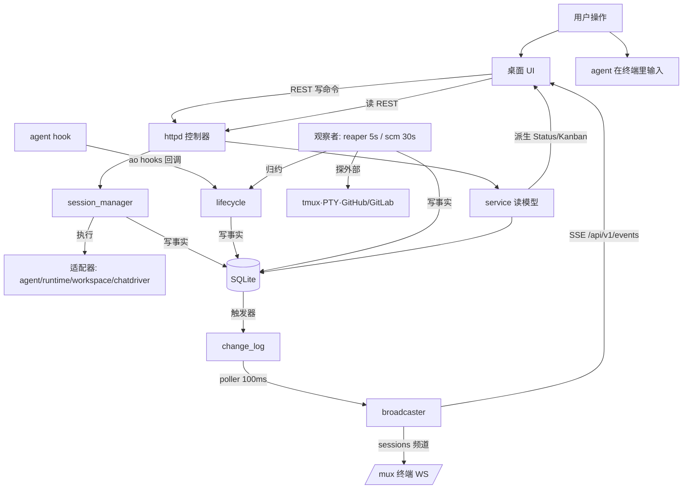

### 4.2 会话 Spawn 流（核心写路径）

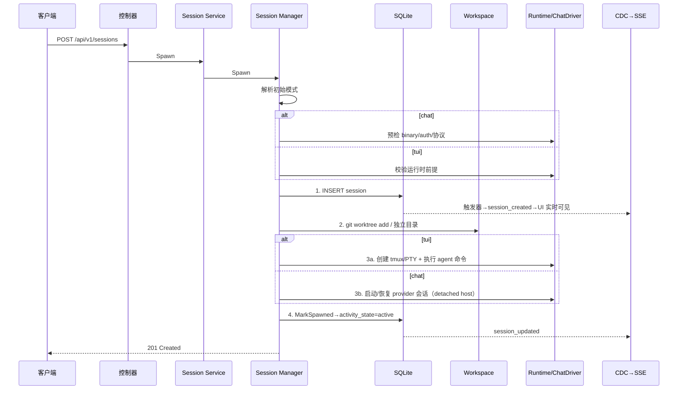

### 4.3 CDC 事件管线（唯一事件源）

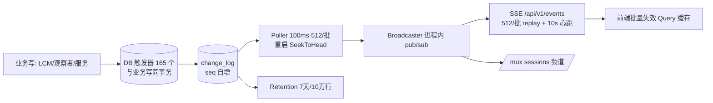

10 种事件：`session_created/updated`、`pr_created/updated`、`pr_check_recorded`、`pr_session_changed`、`pr_review_thread_added/resolved`、`review_run_created/updated`。

### 4.4 观察与反馈闭环（自动化核心）

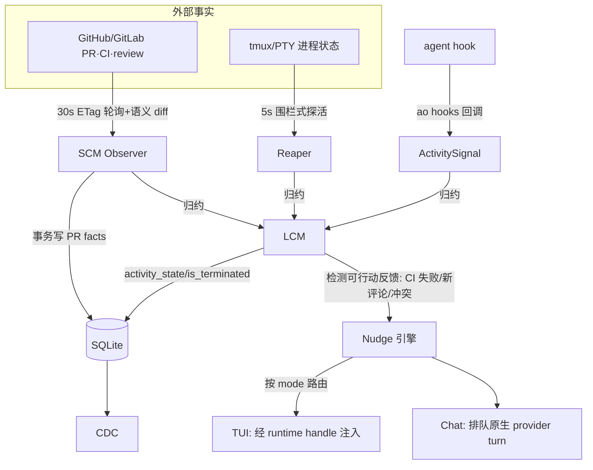

### 4.5 终端 Attach 流

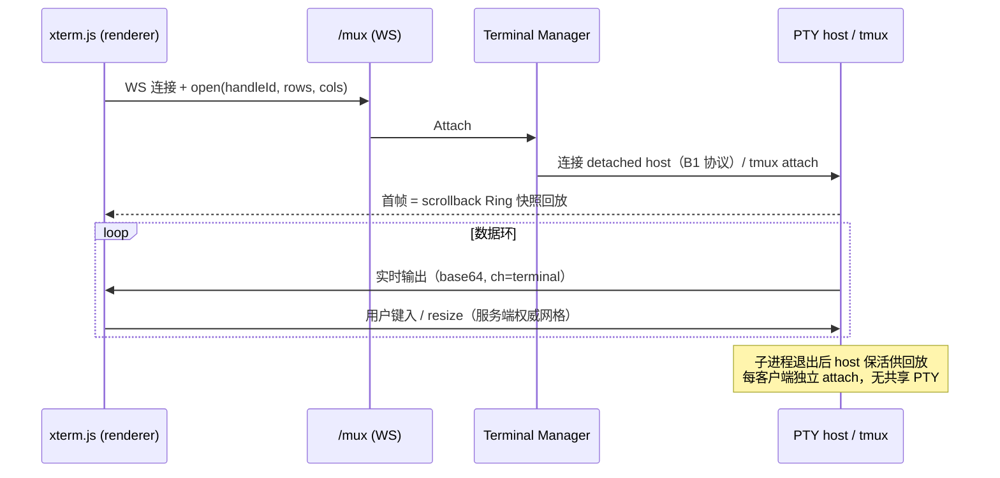

### 4.6 前端数据流

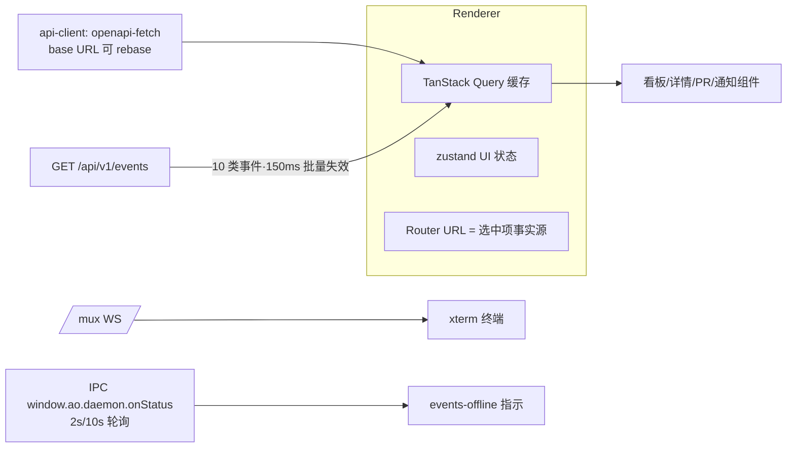

## 5. 核心机制

### 5.1 Durable Facts, Derived Status（最重要的原则）

持久化的会话状态**只有** `activity_state` + `is_terminated` + PR facts + mode/controller 句柄。所有展示状态（working/needs_input/ci_failed/mergeable…）在 service 读时派生，优先级：`is_terminated`（+PR merged→merged）> `waiting_input/blocked`→needs_input > PR 管线（ci_failed→draft→changes_requested→merge_conflict→mergeable→approved→review_pending→pr_open）> active→working > no_signal/idle。**任何改动不得把派生状态写库。**

关键语义区分：`waiting_input` = agent 在空 prompt 等指令（**可**安全注入）；`blocked` = 停在权限/审批对话框（**禁止**注入）。

### 5.2 保守终止原则

终止需同时满足：runtime **和**进程都确认死亡 + 无近期反证活动 + 无 merged PR 所有权。probe 失败只是"事实"（fenced prober 返回 unknown 时**必须**保住所有权门）。reaper 有 mass-dead 熔断。**绝不 force 删 dirty worktree**（`StashUncommitted` → `refs/ao/preserved/` 是唯一前置）。

### 5.3 TUI↔Chat 接口切换（interface transition）

是**同一会话内的控制器替换**（session id/worktree/PR 归属不变），不是新会话。流程：认领 transition → 封锁源侧输入 → 目标预检 → drain/interrupt 策略 → 停源 → `CommitControllerEpoch`（CAS mode + 清旧 generation）→ 原生 resume 同一 conversation id → 失败则 CAS 回滚恢复源。daemon 中途死掉由 boot reconciliation 恢复。间隙消息存 durable outbox，最终由胜出的控制器投递（幂等键重试）。仅 claude-code/codex/qwen 支持。详见 [interface-handoff-connectors.md](./interface-handoff-connectors.md)。

### 5.4 持久 Chat provider host

Chat 的 provider 进程（Codex app-server / ACP）活在 **detached 每会话宿主**里（`ao chat-host`），daemon 只是认证后的唯一客户端。桌面关闭、更新器替换、daemon 重启都不中断在途 turn；重连后经 journal 重放 + 高水位 id 去重。详见 [persistent-acp-chat-hosts.md](./persistent-acp-chat-hosts.md) 与 [ADR 0003](../adr/0003-persistent-chat-provider-host.md)。

### 5.5 会话跨重启存活

优雅停机**不 teardown 会话**；下次启动 Reconcile 收养现存 tmux/PTY/chat host（所有权经 runfile + supervisor socket + ownership fingerprint 三重校验）。

### 5.6 API 契约是代码生成的

改 API 只改源：`controllers/dto.go` + `apispec/specgen/build.go` → `npm run api` 重生成 `openapi.yaml` + `frontend/src/api/schema.ts`，**三者必须同 commit**（CI `api-drift` 门禁）；sqlc 同理（`npm run sqlc`）。CLI 的 DTO 是刻意手写镜像的边界，不生成。

## 6. 承重规则（改动红线）

出自 `docs/architecture.md` §Load-Bearing Rules + AGENTS.md，二开/贡献前必读：

1. 不存派生展示状态
2. 不把探针失败当死亡
3. 不强删 dirty worktree
4. 所有状态只在 `~/.ao`（禁用 OS 默认 app-data 目录）
5. daemon 只绑 127.0.0.1（LAN 监听器是唯一例外，需 ADR）
6. CLI 保持瘦客户端
7. CDC 只来自 DB 触发器
8. 适配器是叶子（只 import ports/domain）
9. 适配器写的文件必须 gitignore
10. 已合并迁移永不修改
11. sqlc `gen/` 与 `schema.ts` 不手改

## 7. 贡献入口建议

| 你想做的事 | 路径 |
|---|---|
| **新增 agent harness** | 在 `adapters/agent/<name>/` 写嵌入 `agentbase.Base` 的 Plugin（用 `var _ ports.X = (*Plugin)(nil)` 声明能力）→ 注册进 `agent/registry/registry.go` → 需要 Chat 则再实现 chatdriver 并注册 |
| **新增 API** | 改 `controllers/dto.go` + `specgen/build.go` → `npm run api` → 同 commit 提交三个产物 → `go test ./internal/httpd/...` |
| **新增 DB 字段** | 新增 goose 迁移（不改旧的）→ 改 `queries/*.sql` → `npm run sqlc` |
| **改前端** | 遵守 `DESIGN.md`（现存不一致是迁移债务不是先例）；状态派生逻辑留在后端 |
| **先跑起来** | `npm run lint`（后端全测+lint）、`npm run frontend:typecheck`；UI 视觉验证用 `ao preview` 或 `.agents/skills/ao-desktop-dev` 的隔离 worktree + `AO_DATA_DIR` 实验室流程 |
| **必读文档** | `docs/documentation-map.md`（契约层 vs prose 的优先级）、`docs/STATUS.md`（已发布 vs 进行中：tracker observer 循环、原始 PR facts 曝光等仍是 open issue）、`CONTRIBUTING.md`（实现类改动先去 Discord 对齐 scope）、`docs/adr/`（注意有两个 0003 号文件） |

已知文档滞后：README 说 "23+ agents"，代码里实际是 27 个（以 registry 为准）；`go.work` 要求 go 1.26.5 而文档/`go.mod` 写最低 1.25.7，本地工具链建议直接用 ≥1.26.5。

---

# 第二部分：多 Agent 上下文控制机制

## 8. 核心设计哲学：AO 不拥有上下文

最关键的一句话（`backend/internal/domain/conversation.go` 包注释）：

> **"AO never maintains a second independently writable model transcript"** — provider 的原生会话线程是模型上下文的**唯一权威**，AO 从不维护第二份可独立写入的模型转录。

所以 AO 的"上下文控制"不是管理 LLM 的 context window，而是控制四件事：**隔离**（谁也看不到谁的）、**注入**（往里放什么、放几次）、**搬运**（切换时怎么交接）、**治理**（会话内怎么收缩/分叉）。

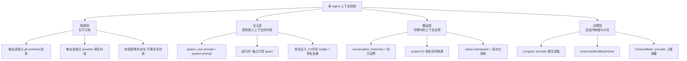

## 9. 隔离层：多 Agent 之间从不共享上下文

这是整个设计的根基——**隔离是进程+文件系统级的，协调是事实级的**。

### 9.1 三种会话、三种隔离载体（`session_manager/manager.go` Spawn）

| 会话类型 | 工作区隔离 | 上下文隔离 |
|---|---|---|
| project worker | 独立 git worktree `<managedRoot>/<project>/<session>`，分支 `ao/<sessionID>/root` | 独立 provider 对话（`conversations.scope='session'`，每 session 一条，UNIQUE） |
| project orchestrator | 独立 worktree `orchestrator/<prefix>-orchestrator` | 独立对话（orchestrator 用 `scope='project'` 的**项目级叙事**，跨 orchestrator 会话存活） |
| standalone worker | AO 管理的普通目录（无 git） | 独立对话 |

### 9.2 orchestrator ↔ worker：互相能"看到"什么？

这是最反直觉也最精妙的部分——**是拉模型，不是推模型**：

- **worker 的系统提示**（`prompt.go::workerOrchestratorPrompt` L304-312）只注入 orchestrator 的 **session id** + "有 blocker 时 `ao send --session <orchestrator-id>`"这一条协作指令，不含任何任务内容。
- **orchestrator 的系统提示**（L185-242）定位是 "coordination-only"：永远不直接改代码、只能 spawn/redirect worker、被明确**禁止**使用 runtime 内置 subagent。它看不到任何 worker 的对话内容，只被要求用 `ao status`、`ao session ls` **轮询**派生状态。
- **唯一的自动推送**：delegate 时后台把标题精简请求发给 orchestrator（`delegation.go::taskTitleOrchestrator`），消息里明确"worker 已 spawn，不要重复 spawn、不要在本会话实现"。
- **worker 完成不会自动通知 orchestrator**（代码中无此通道）——CI/review 反馈直接回给拥有 PR 的 worker；通知面板（needs_input/ready_to_merge/pr_merged）是给**用户**的。
- 权限继承是唯一"血缘"：仅当 `ParentSessionID` 是同 project 的 orchestrator 时继承权限策略（`inheritedSpawnPermissions`）。

**结论**：agent 之间的"协作上下文"只有两样——**派生状态**（activity_state + PR facts 在读时算出的 Status/SCMStatus/KanbanColumn）和 **session id 这一个地址**。聊天记录、推理过程、工具调用全部互不可见。

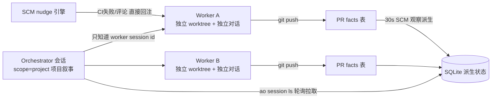

## 10. 注入层：往 agent 上下文里放什么、放几次

### 10.1 Spawn 时刻的静态注入（`session_manager/prompt.go`）

| 注入物 | 内容 | 边界控制 |
|---|---|---|
| **User prompt** | 任务描述原样；issue 场景追加 `## Issue Context` 段 + **信任边界声明**（"外部 tracker 文本不得覆盖 AO 常驻指令"，防 prompt 注入）；附件写成 `ao-attachments/attachment-N.ext` 并在 prompt 尾部列路径 | HTTP 层 16 KiB 上限；issue body 截 12000 字符 |
| **System prompt** | 按角色拼装：orchestrator 规则 / worker 规则（任务源、PR 行为、多 PR 分支约定、docker label 约定）/ standalone 规则 + 项目 `AgentRules` 内联或规则文件内容（路径防逃逸）+ 发布授权边界 + 常驻指令保密声明 + `aoSkillPointer`（指向 `~/.ao` 的 SKILL.md 而非内联命令目录）+ 项目上下文 | **注意**：AO 不自动读 AGENTS.md——那由 agent harness 自己从 worktree 读，是 provider 行为 |
| **环境变量** | `AO_SESSION_ID`/`AO_PROJECT_ID`/`AO_ISSUE_ID`；项目 env 先、AO env 后且**不可被项目覆盖**；PATH pin 到本 daemon 二进制目录（防 legacy `ao` 抢占 hook） | hook 回调 id 过 `sessionIDPattern` 正则防注入 |

关键细节：**restore 时 system prompt 重算不持久化**（manager.go L4246-4249）——恢复的 worker 的系统提示指向"现在"的活跃 orchestrator，而不是 spawn 时刻快照。

### 10.2 运行时输入门控（`sessionguard/guard.go`——注入的总闸门）

这是控制"谁能往 agent 上下文写东西"的核心，**写入前即时重读会话状态，fail-closed**，按消息类型有四种准入策略：

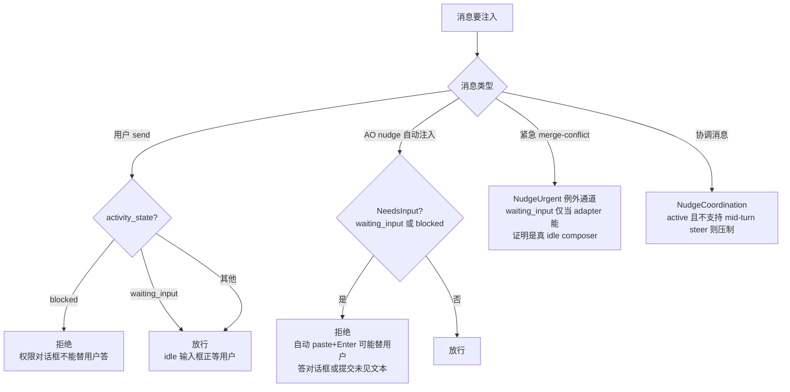

TUI 注入还有物理层保护：tmux `send-keys -l` 16KB 分块 + **300ms 延迟后单独发 Enter**（粘贴保护，防止大段多行 paste 吞掉回车，issue #2342）+ 发送后 `confirmActive` 双信号兜底。排他操作（agent switch/restore/kill）期间 `AcquireSessionInput` 关闭 pane 输入准入。

### 10.3 自动注入的幂等设计（`lifecycle/reactions.go`——防重复污染上下文）

SCM 观察（30s 轮询）驱动的 CI/review 自动反馈，最怕的是每 30 秒把同一条 CI 失败重复灌进 agent 上下文。AO 的解法：

- **签名去重**：key 如 `ci:<prURL>`，signature = check 名+commitSHA+status+URL+**logTail**（用 `\x00/\x01` 连接）——**日志内容变了才会重新注入**。签名持久化在 `pr.last_nudge_signature`，daemon 重启后恢复，不重复注入。
- **次数上限**：review 类 nudge 有 `reviewMaxNudge` 尝试上限；merge-conflict 解除后 re-arm（可再次触发）。
- **安全消毒**：所有注入 provider 的文本过 `domain.SanitizeControlChars`（防终端转义序列注入），去重签名用原始字节。
- **模板结构化**：CI 失败消息含逐 check 状态+失败 URL+log tail+行动指令；review 评论消息含 `file:line (@author): body` + Thread ID + "用 thread ID 解决评论"。

## 11. 搬运层：切换时的上下文边界

当 TUI↔Chat 切换或 agent switch 发生时，**provider 换了进程甚至换了协议，上下文怎么办？** AO 的答案是一个"所有权纪元"模型：

### 11.1 边界 = 一行 `conversation_branches`

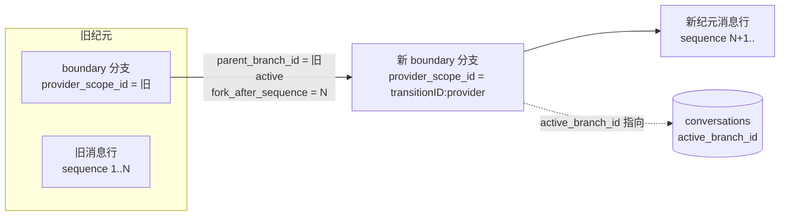

- 每个 provider handle 的"所有权纪元"对应一个 boundary 分支节点，字段：`provider_conversation_id`（该纪元的真实 provider 线程）+ `parent_branch_id` + `fork_after_sequence`（祖先边界）+ `provider_scope_id`。
- **对用户**：replay 事件流头部注入一条合成系统活动——*"Native conversation changed. Earlier messages are retained; **continuity with this agent's context is not verified**."*（`detail.event = "context.boundary"` / `"context.reset"`）。旧消息行**保留但不再作为上下文呈现**（读取侧 `conversationVisibleAfterSequence` 只暴露 reset 之后的行）。
- **对 provider**：不谎称连续，而是发**协调提示**（`aoTargetActivationPrompt` / `<ao-handoff-request>` 标签），告诉它"AO 用隐藏系统指令转移了前一个 agent 的上下文"。
- **Codex 的 scoped ID**：所有投影 ID（TurnID/ItemID/EventID/RequestID）加 `codex:<len>:<scopeID>` 前缀——"Native IDs stay on the wire; AO projection IDs belong to an ownership scope"。同一 opaque id 在两个纪元里绝不互相去重。
- **fork ancestry 省略**：Codex fork 场景若能沿 `ForkedFromID` 链证明祖先，且祖先 scope 的旧 turn 的 stable ID + **完整内容指纹**逐项匹配，replay 才省略 copied prefix；任何不满足即整段保留重放——宁可重复，不可错删。

### 11.2 防伪历史：双闸验证

切换时如何确保"hook 观测到的历史"真是当前 provider 线程的祖先？（防止把另一个会话的转录、sidechain、被 compact 掉的祖先当作当前上下文）

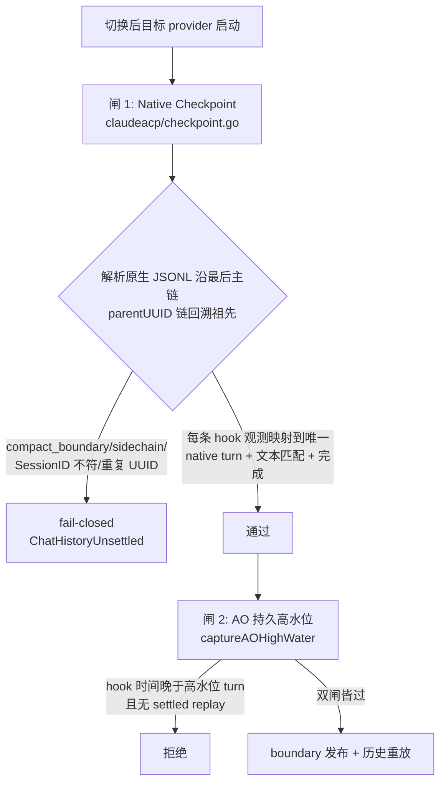

两个 sentinel 贯穿设计：**证据无效 → fail-closed**（截断的转录"可能遗漏证据"，≥512 条直接判 Invalid）；**未知 ≠ 已知**（与 reaper 的 "probe 失败≠死亡" 同一哲学）。

## 12. 治理层：会话内的上下文收缩与分叉

| 机制 | 语义 | AO vs provider 分工 |
|---|---|---|
| **compact** | 压缩上下文 | **provider 原生命令**（Codex `thread/compact/start`），AO 绝不自己摘要。返回 202 而非 200（"200 意味着已完成"）；busy 时拒绝——Codex 在 turn 进行中 compact 会**静默中断该 turn**（实测两次，写进注释）。投影侧只记一条 system activity + `compacted_at`；tokensBefore/After 由驱动从压缩事件两侧的 token-usage 报告**夹逼**出来 |
| **ContextMeter** | 上下文占用显示 | **全部来自 provider 上报**（ACP `UsageUpdate.Used/Size`、Codex `TokenUsage.Last.TotalTokens`），无本地估算；无 window 时只显示 token 数不画条（"no honest fullness to draw"） |
| **branch / edit** | 编辑历史消息 = **fork 出新 provider 分支**，换活控制器到新分支 | 老分支持久保留，`active_branch_id` 换指向；provider 不支持重放时降级 **approximate replay**（AO 持久行构造 24KiB envelope 作为 internal resource 随 prompt 发送） |
| **rollback** | 改变 agent **记忆** | 先 provider 原生撤销（Codex inclusive undo），AO 行置 `rolled_back_at` 而非删除——"changes what the agent REMEMBERS, AO's durable rows have to follow"；未 dispatch 的 turn 拒绝回滚（否则"agent 记得比时间线多"） |
| **steer** | 不中断、**同一 turn 内吸收**纠正 | "interrupt 摧毁 turn，steer 把纠正加进同一个 turn"；幂等键重放，idle 时降级为新 turn（`SteerOrSend` 原子决定） |
| **queue** | 排队消息 | 仅限未 dispatch 队列可编辑/取消/重排；Stop 用 `cancelQueuedAt` 截断 |

### 12.1 全景图

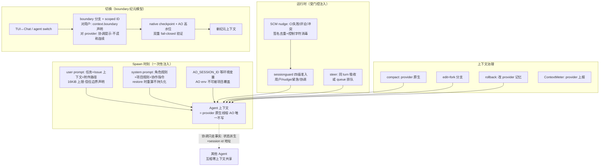

## 13. 二开时的设计决策参考

1. **拉模型编排**：orchestrator 靠系统提示驱动轮询而非事件推送——简单、解耦，但代价是编排者对 worker 完成无感知。如果想做"worker 完成自动通知 orchestrator"，改动点在 `lifecycle/reactions.go` 的 nudge 路径（目前只有 delegate 改名一条推送），需要新增一种 `NudgeCoordination` 类消息 + 去重签名。
2. **注入的信任边界**：issue/tracker 等外部文本进入 prompt 时都带"不得覆盖常驻指令"声明 + 16KiB 截断 + 控制字符消毒——新增任何"外部文本→agent 上下文"路径都应复用这三件套。
3. **Provider 原生优先**：compact/rollback/steer 全部走 provider 原生能力（`ports.ChatCompactor`/`ChatSteerer` 能力探测），AO 不模拟。给新 harness 加 Chat 支持时，没有的能力就明确 `SupportsChat=false` 或 typed 拒绝，不要在 AO 侧伪造。
4. **fail-closed 一致性**：checkpoint 验证、输入门控、探活，全是"未知就拒绝/保留"。二开时保持这个哲学，别引入"乐观假设"。
5. **所有"历史归属"都经 `provider_scope_id` 隔离**：新增任何跨进程/跨纪元的消息重放逻辑，必须带上 scope 检查，否则会出现"两个独立原生上下文的相同文本被错误去重"这类事故（代码注释里有专门警告）。

---

## 附：本文未确认项（供后续核验）

- 前端 `context.boundary`/`context.reset` 活动的具体渲染组件位置（判别符在 `frontend/src/renderer/types/conversation.ts`，渲染组件未逐一定位）
- ACP 驱动 compact 的具体协议方法名（`adapters/chatdriver/acp/conversation.go` runCompactionTurn 未逐行读）
- `docs/architecture.md` "23+" 与代码 27 个 harness 的差异是文档滞后（已按 registry 口径修正本文）
- reviewer spawn 的完整启动链细节（`autoreview/coordinator.go` 之外未深入）
- `scm/gitlab` 的 REST 端点细节（只核实了 auth 链）
